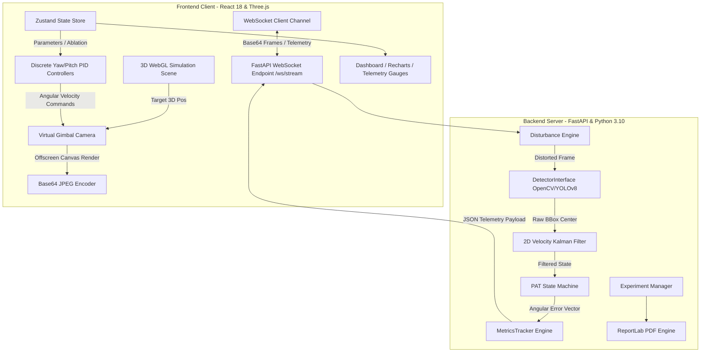

# FSOC AI-Based Virtual Camera Tracking System

An aerospace-grade closed-loop pointing, acquisition, and tracking (PAT) software simulation suite designed for coarse alignment of mobile Free-Space Optical Communication (FSOC) terminals. The platform integrates a dynamic WebGL 3D environment, pinhole virtual camera model, real-time computer vision / AI target detection (YOLOv8 & OpenCV HSV fallback), 2D Kalman Filter state estimation, discrete anti-windup PID controller, 6-DoF environmental disturbance engine, 10 predefined benchmark scenarios, and automated technical PDF report compilation.


[](https://fsoc-frontend-pcky.onrender.com/)

> [!NOTE]
> 🌐 **Live Web Application Link**: [https://fsoc-frontend-pcky.onrender.com/](https://fsoc-frontend-pcky.onrender.com/)

### 🛰️ Beacons Color Code Legend
- **BEACON-01 (Designated Target)**: 🟢 Emerald Green (`#10B981`)
- **BEACON-02**: 🔵 Blue (`#3B82F6`)
- **BEACON-03**: 🟡 Amber (`#F59E0B`)
- **BEACON-04**: 🌸 Pink (`#EC4899`)

---

## 📌 SIH Problem Statement

- **Problem Statement ID**: 26169
- **Problem Statement Title**: Development of an AI-Based Virtual Camera Tracking System for Coarse Alignment of Mobile Free Space Optical Communication (FSOC) Terminals
- **Category**: Software / Aerospace & Communication Systems
- **Official Problem Summary**: Free Space Optical Communication (FSOC) requires sub-milliradian beam pointing between mobile terminals (e.g., satellites, UAVs, aircraft). PAT operations occur in two phases: Coarse Alignment and Fine Alignment. Developing and testing physical PAT mechanisms requires expensive optical components, high-precision pan-tilt gimbals, and dedicated cameras. This project delivers a software-based virtual camera tracking system that provides an accessible, cost-effective, and flexible closed-loop testing environment for algorithm development, noise robustness validation, and alignment performance evaluation without physical hardware dependencies.

---

## 🌐 About FSOC

Free Space Optical Communication (FSOC) uses modulated near-infrared optical beams to achieve gigabit-to-terabit wireless communication links across satellites, uncrewed aerial vehicles (UAVs), airborne assets, and ground stations. FSOC offers significant advantages over conventional radio frequency (RF) communications:
- **Massive Data Rates**: Multi-gigabit to terabit throughput due to high-frequency optical carriers.
- **Unlicensed Spectrum**: Immune to RF spectrum congestion and regulatory spectrum licensing limits.
- **Electromagnetic Immunity**: Non-interfering and resistant to RF jamming, interception, and electronic warfare.

However, laser divergence angles are extremely narrow (sub-milliradian to microradian). Even minor mechanical vibrations, wind gusts, or target motion cause link outage. Prior to fine alignment (which uses Fast Steering Mirrors and Quadrant Photodiodes), the **Coarse Alignment** system must autonomously acquire the optical beacon, project its coordinates onto a tracking sensor, and continuously command a two-axis (Pan-Tilt) gimbal to maintain target lock inside the camera Field of View (FOV).

---

## 🎯 Problem We Are Solving

Testing coarse alignment algorithms on physical hardware is bottlenecked by high procurement costs, mechanical gimbal wear, non-reproducible atmospheric turbulence, and field testing constraints. 

Our system solves this challenge by implementing a software-defined **closed-loop hardware-in-the-loop (HIL) simulation surrogate**:
1. Replaces physical cameras with an intrinsic perspective pinhole camera model.
2. Replaces physical pan-tilt gimbals with 60Hz discrete PID-driven WebGL actuators.
3. Replaces optical laser beacons with dynamic 3D light-emitter nodes traveling along configurable spatial trajectories.
4. Emulates realistic atmospheric and platform disturbances (scintillation, Gaussian blur, sensor noise, platform vibration, wind jitter).
5. Provides reproducible evaluation benchmarks and telemetry logging without needing physical optical hardware.

---

## 💡 Our Proposed Solution

The **FSOC AI-Based Virtual Camera Tracking Simulator** combines a modern React 18 / Three.js frontend client with a high-performance Python FastAPI backend server over a dual-channel WebSocket pipeline. 

```
[ WebGL 3D Scene ] ──(Render Frame)──> [ Camera Pinhole Model ]
        ▲                                          │
        │ (Pan/Tilt Velocity Commands)             ▼ (Base64 JPEG Feed)
[ Discrete Anti-Windup PID ] <── [ PAT State Machine ] <── [ 2D Kalman Filter ] <── [ OpenCV / YOLOv8 Detector ]
```

The system forms an end-to-end closed loop:
- **Frontend** simulates the 3D world, projects target coordinates onto an offscreen WebGL render target, streams base64 frame data to the backend at 60Hz, and executes local 60Hz yaw/pitch motor updates.
- **Backend** ingests raw frames, applies configurable environmental disturbances, executes AI/OpenCV target detection, runs a 2D velocity-estimating Kalman filter, evaluates state transitions, and streams telemetry back to the frontend.

---

## 🚀 Key Features

- **Dynamic WebGL 3D Simulation**: Real-time rendering of customizable 3D optical beacons with multi-beacon support, configurable spatial trajectories (Linear, Circular, Sine-wave, Random Walk, Spiral), adjustable velocities, and designated target selection.
- **Hybrid AI / Computer Vision Detector**: Dual-backend vision pipeline featuring deep neural detection ([`YOLODetector`](file:///c:/Users/Manish/Desktop/FSOC-AI-Virtual-Camera-Tracking/backend/app/detection/detector.py#L106-L183)) with an ultra-fast HSV color thresholding fallback ([`OpenCVDetector`](file:///c:/Users/Manish/Desktop/FSOC-AI-Virtual-Camera-Tracking/backend/app/detection/detector.py#L24-L105)) utilizing morphological filtering and circularity contour constraints.
- **State Estimation & Occlusion Handling**: 4D state vector 2D linear Kalman Filter ([`KalmanFilter2D`](file:///c:/Users/Manish/Desktop/FSOC-AI-Virtual-Camera-Tracking/backend/app/tracking/kalman.py#L7-L157)) for continuous trajectory prediction during atmospheric fading, target loss, or temporary optical occlusions up to 2.0 seconds.
- **6-State PAT State Machine**: Finite state machine ([`TrackingStateMachine`](file:///c:/Users/Manish/Desktop/FSOC-AI-Virtual-Camera-Tracking/backend/app/tracking/state_machine.py#L14-L122)) managing transitions (`SEARCHING` ➔ `DETECTED` ➔ `ACQUIRING` ➔ `TRACKING` ➔ `LOCKED` ➔ `TARGET_LOST`) with automated raster and spiral search pattern triggers during acquisition loss.
- **Physical Gimbal Control Emulation**: Decoupled Yaw (Pan) and Pitch (Tilt) discrete PID controllers ([`PIDController`](file:///c:/Users/Manish/Desktop/FSOC-AI-Virtual-Camera-Tracking/frontend/src/utils/pid.js#L1-L64)) with anti-windup integral clamping, deadband jitter damping, and angular velocity limits.
- **6-DoF Environmental Disturbance Engine**: Real-time modeling of atmospheric turbulence (spatial remap wobble & scintillation), platform vibration (harmonic X/Y translation), camera jitter (wind shock with exponential recovery), sensor CCD noise (Gaussian + salt-and-pepper), atmospheric blur, and illumination variation (3Hz brightness flicker) ([`DisturbanceEngine`](file:///c:/Users/Manish/Desktop/FSOC-AI-Virtual-Camera-Tracking/backend/app/detection/disturbances.py#L9-L164)).
- **10 Predefined Benchmark Scenarios**: Preconfigured testing scenarios ([`scenarios.json`](file:///c:/Users/Manish/Desktop/FSOC-AI-Virtual-Camera-Tracking/configs/scenarios.json#L1-L323)) evaluating alignment performance under baseline, high-speed, heavy noise, target occlusion, camera jitter, and combined stress test conditions.
- **Automated SIH Demo & Comparative Matrix**: One-click automated E2E evaluation suite running comparative ablation studies, telemetry logging, live Recharts tracking metrics, and automated PDF technical report generation with embedded Matplotlib timeline plots ([`reports.py`](file:///c:/Users/Manish/Desktop/FSOC-AI-Virtual-Camera-Tracking/backend/app/experiments/reports.py#L1-L245)).

---

## 🏗️ System Architecture

### High-Level Architecture Diagram



### Major Software Modules Breakdown

1. **Camera Projection Model** ([`backend/app/camera/model.py`](file:///c:/Users/Manish/Desktop/FSOC-AI-Virtual-Camera-Tracking/backend/app/camera/model.py)):
   Computes camera intrinsic matrix $K$, focal lengths $f_x, f_y$ from FOV specifications, combined $R_y(\theta_p) R_x(\theta_t)$ rotation matrices, world-to-camera coordinate transformations, and pixel coordinate projections.
2. **AI & Vision Pipeline** ([`backend/app/detection/detector.py`](file:///c:/Users/Manish/Desktop/FSOC-AI-Virtual-Camera-Tracking/backend/app/detection/detector.py)):
   Processes incoming 640x480 pixel arrays using OpenCV color space transformations (BGR to HSV), morphologic noise reduction, circularity filtering ($4\pi \cdot \text{Area} / \text{Perimeter}^2 > 0.4$), or Ultralytics YOLOv8 inference when available.
3. **Disturbance Engine** ([`backend/app/detection/disturbances.py`](file:///c:/Users/Manish/Desktop/FSOC-AI-Virtual-Camera-Tracking/backend/app/detection/disturbances.py)):
   Injects physical platform and optical distortions directly onto frame buffers and geometric coordinates based on configurable percentage sliders (0-100%).
4. **Kalman Filter Estimator** ([`backend/app/tracking/kalman.py`](file:///c:/Users/Manish/Desktop/FSOC-AI-Virtual-Camera-Tracking/backend/app/tracking/kalman.py)):
   Tracks target kinematics $\mathbf{x} = [x, y, v_x, v_y]^T$ using constant-velocity state transition matrices and covariance matrices. Maintains linear velocity vectors during complete target occlusion windows up to 2 seconds.
5. **Tracking State Machine** ([`backend/app/tracking/state_machine.py`](file:///c:/Users/Manish/Desktop/FSOC-AI-Virtual-Camera-Tracking/backend/app/tracking/state_machine.py)):
   Enforces operational tracking state transitions, loss timeouts, lock stability counters ($<0.15^\circ$ error sustained for $0.5\text{s}$), and automated raster/spiral scan pattern triggers.
6. **Telemetry & Metrics Tracker** ([`backend/app/tracking/metrics.py`](file:///c:/Users/Manish/Desktop/FSOC-AI-Virtual-Camera-Tracking/backend/app/tracking/metrics.py)):
   Logs frame-by-frame timestamps, detection latencies, pixel coordinates, angular pointing errors, lock retention rates, and generates statistical summaries.
7. **Experiment Manager & PDF Generator** ([`backend/app/experiments/manager.py`](file:///c:/Users/Manish/Desktop/FSOC-AI-Virtual-Camera-Tracking/backend/app/experiments/manager.py) & [`reports.py`](file:///c:/Users/Manish/Desktop/FSOC-AI-Virtual-Camera-Tracking/backend/app/experiments/reports.py)):
   Executes automated benchmark scenarios, saves structured CSV/JSON logs, and renders 2-page academic PDF report documents with Matplotlib timeline charts via ReportLab.
8. **Frontend Closed-Loop Gimbal** ([`frontend/src/scene/GimbalCamera.jsx`](file:///c:/Users/Manish/Desktop/FSOC-AI-Virtual-Camera-Tracking/frontend/src/scene/GimbalCamera.jsx)):
   Executes a 60Hz React Three Fiber `useFrame` loop that applies discrete PID outputs to pan/tilt Euler rotations, captures camera canvas contents, and updates local 3D render states.

---

## 🔄 System Workflow

The closed-loop tracking process operates across 10 sequential stages:

```
┌─────────────────────────────────────────────────────────────────────────┐
│ 1. Environment & Target Generation (Three.js 3D Beacons)                 │
└────────────────────────────────────┬────────────────────────────────────┘
                                     ▼
┌─────────────────────────────────────────────────────────────────────────┐
│ 2. World Coordinate Update (Trajectory Math: Linear/Circular/Spiral)    │
└────────────────────────────────────┬────────────────────────────────────┘
                                     ▼
┌─────────────────────────────────────────────────────────────────────────┐
│ 3. Pinhole Projection & Frame Capture (Gimbal Perspective Camera)      │
└────────────────────────────────────┬────────────────────────────────────┘
                                     ▼
┌─────────────────────────────────────────────────────────────────────────┐
│ 4. WebSocket Base64 Transmission to Backend (/ws/stream)                │
└────────────────────────────────────┬────────────────────────────────────┘
                                     ▼
┌─────────────────────────────────────────────────────────────────────────┐
│ 5. Environmental Disturbance Injection (Vibration/Noise/Turbulence)     │
└────────────────────────────────────┬────────────────────────────────────┘
                                     ▼
┌─────────────────────────────────────────────────────────────────────────┐
│ 6. Computer Vision Detection (OpenCV HSV / YOLOv8 Bounding BBoxes)      │
└────────────────────────────────────┬────────────────────────────────────┘
                                     ▼
┌─────────────────────────────────────────────────────────────────────────┐
│ 7. Kalman Filter State Update / Occlusion Prediction                    │
└────────────────────────────────────┬────────────────────────────────────┘
                                     ▼
┌─────────────────────────────────────────────────────────────────────────┐
│ 8. PAT State Machine Transition Evaluation (SEARCHING to LOCKED)       │
└────────────────────────────────────┬────────────────────────────────────┘
                                     ▼
┌─────────────────────────────────────────────────────────────────────────┐
│ 9. Discrete PID Controller Output Calculation (Yaw/Pitch Velocities)    │
└────────────────────────────────────┬────────────────────────────────────┘
                                     ▼
┌─────────────────────────────────────────────────────────────────────────┐
│ 10. Gimbal Actuator Rotation & Real-Time Performance Log Telemetry      │
└─────────────────────────────────────────────────────────────────────────┘
```

---

## 🧠 AI / Computer Vision Pipeline

The vision pipeline converts raw uncalibrated camera frames into clean target pixel coordinates:

```
[ Raw Frame ] ──> [ Disturbance Engine ] ──> [ HSV Conversion ] ──> [ Color Masking ] 
    ──> [ Morphological Opening/Closing ] ──> [ Contour Analysis & Circularity Filter ] ──> [ Target Centroid ]
```

### 1. Color Space Conversion & Thresholding
- Images are converted from BGR to HSV color space.
- Default HSV threshold ranges ($H \in [35, 95]$, $S \in [50, 255]$, $V \in [50, 255]$) isolate bright optical laser emissions.

### 2. Morphological Filtering
- A $3 \times 3$ rectangular kernel executes morphological opening (`MORPH_OPEN`) to eliminate isolated specular noise pixels, followed by morphological closing (`MORPH_CLOSE`) to fill internal void areas inside bright beacon spots.

### 3. Contour Extraction & Shape Constraints
- Contours are identified using `cv2.findContours`.
- Candidates are filtered by area ($10 \le \text{Area} \le 0.5 \cdot W \cdot H$) and circularity ($\mathcal{C} = \frac{4 \pi \cdot \text{Area}}{\text{Perimeter}^2} > 0.4$) to reject non-spherical ambient light sources.

### 4. Neural YOLOv8 Fallback Integration
- When enabled in `hybrid` or `yolo` mode, an Ultralytics YOLOv8 weights file (`models/beacon_detector.pt`) detects optical terminal bounding boxes. If inference latency exceeds limits or PyTorch is unavailable, the interface safely falls back to the OpenCV HSV pipeline without dropping the frame loop.

### 5. 2D Linear Kalman Filter
The state vector represents 2D image plane kinematics:

$$\mathbf{x}_k = \begin{bmatrix} x \\ y \\ v_x \\ v_y \end{bmatrix}_k, \quad \mathbf{z}_k = \begin{bmatrix} x \\ y \end{bmatrix}_k$$

- **State Transition Matrix $\mathbf{A}$**:
  $$\mathbf{A} = \begin{bmatrix} 1 & 0 & \Delta t & 0 \\ 0 & 1 & 0 & \Delta t \\ 0 & 0 & 1 & 0 \\ 0 & 0 & 0 & 1 \end{bmatrix}$$
- **Process Noise Matrix $\mathbf{Q}$**:
  $$\mathbf{Q} = q \cdot \begin{bmatrix} \frac{\Delta t^4}{4} & 0 & \frac{\Delta t^3}{2} & 0 \\ 0 & \frac{\Delta t^4}{4} & 0 & \frac{\Delta t^3}{2} \\ \frac{\Delta t^3}{2} & 0 & \Delta t^2 & 0 \\ 0 & \frac{\Delta t^3}{2} & 0 & \Delta t^2 \end{bmatrix}$$
- **Measurement Matrix $\mathbf{H}$**:
  $$\mathbf{H} = \begin{bmatrix} 1 & 0 & 0 & 0 \\ 0 & 1 & 0 & 0 \end{bmatrix}$$

When target occlusion occurs, measurement updates are bypassed, and `predict_only()` computes the expected position from prior velocity parameters for up to 2.0 seconds.

---

## 🎥 Virtual Camera System

The virtual camera models a high-speed narrow-field-of-view sensor mounted on a 2-axis motorized gimbal:

```
Camera Sensor Resolution: 640 x 480 pixels
Horizontal FOV (HFOV):    10.0°
Vertical FOV (VFOV):      7.5°
Mounting Position:        [0.0, 0.0, 0.0] World Center
Rotational Degrees:       Pan (Yaw around Y-axis), Tilt (Pitch around X-axis)
```

### Intrinsic Camera Matrix Equations

The focal lengths $f_x, f_y$ and principal point $(c_x, c_y)$ are computed directly from FOV angles and image resolution:

$$f_x = \frac{W}{2 \tan\left(\frac{\text{HFOV}}{2}\right)}, \quad f_y = \frac{H}{2 \tan\left(\frac{\text{VFOV}}{2}\right)}, \quad c_x = \frac{W}{2}, \quad c_y = \frac{H}{2}$$

### Coordinate Transformations

1. **Gimbal Rotation Matrix $R_c$**:
   Order of rotation follows Three.js Euler convention (`YXZ` - Yaw then Pitch):
   $$R_y(\theta_p) = \begin{bmatrix} \cos\theta_p & 0 & \sin\theta_p \\ 0 & 1 & 0 \\ -\sin\theta_p & 0 & \cos\theta_p \end{bmatrix}, \quad R_x(\theta_t) = \begin{bmatrix} 1 & 0 & 0 \\ 0 & \cos\theta_t & -\sin\theta_t \\ 0 & \sin\theta_t & \cos\theta_t \end{bmatrix}$$
   $$R_c = R_y(\theta_p) \cdot R_x(\theta_t)$$

2. **World to Camera Frame Transformation**:
   $$\mathbf{P}_c = R_c^T \cdot (\mathbf{P}_w - \mathbf{P}_{\text{cam}})$$

3. **Perspective Pixel Projection**:
   Given camera coordinates $[x_c, y_c, z_c]^T$ (where target is in front when $z_c < 0$):
   $$u = f_x \cdot \left(\frac{x_c}{-z_c}\right) + c_x, \quad v = c_y - f_y \cdot \left(\frac{y_c}{-z_c}\right)$$

4. **Angular Pointing Errors**:
   $$\theta_{\text{total}} = \arccos\left( \frac{\mathbf{P}_c \cdot [0, 0, -1]^T}{\|\mathbf{P}_c\|} \right)$$
   $$\epsilon_{\text{pan}} = \arctan2(x_c, -z_c), \quad \epsilon_{\text{tilt}} = \arctan2(y_c, -z_c)$$

---

## 🎮 Simulation Environment

The simulation environment is built with **Three.js / React Three Fiber** ([`SimulationScene.jsx`](file:///c:/Users/Manish/Desktop/FSOC-AI-Virtual-Camera-Tracking/frontend/src/scene/SimulationScene.jsx)):
- **3D World Stage**: Interactive 3D scene equipped with ground grids, distance rings, ambient lighting, directional sun sources, gimbal base geometry, and optical terminal mountings.
- **Dynamic Optical Beacons** ([`Beacon.jsx`](file:///c:/Users/Manish/Desktop/FSOC-AI-Virtual-Camera-Tracking/frontend/src/scene/Beacon.jsx)): High-intensity glowing emissive spheres representing laser terminals.
- **Trajectory Generators**:
  - `Linear`: Constant linear velocity vectors in 3D space ($\mathbf{v} = [v_x, v_y, v_z]$).
  - `Circular`: Orbital trajectories centered at origin with radius $R$ and frequency $\omega$.
  - `Sinewave`: Harmonic oscillations along horizontal and vertical axes.
  - `Random Walk`: Stochastic Brownian motion vectors.
  - `Spiral`: Concentric expanding/contracting spatial orbits.
- **Autonomous Search Patterns**:
  - `Raster Scan`: Systematic horizontal lawnmower sweeps stepping down vertically when target loss occurs.
  - `Spiral Scan`: Expanding Archimedean concentric circular sweeps covering sky sectors.

---

## 🌪️ Disturbance Simulation

The system features a 6-DoF Disturbance Engine ([`disturbances.py`](file:///c:/Users/Manish/Desktop/FSOC-AI-Virtual-Camera-Tracking/backend/app/detection/disturbances.py#L9-L164)) to evaluate algorithm stability under realistic physical degradation:

| Disturbance Mode | Intensity Range | Mathematical / Operational Model | Implemented Effect |
| :--- | :--- | :--- | :--- |
| **Platform Vibration** | 0 - 100% | $15\text{Hz}$ harmonic translation: $dx = A \sin(2\pi f t), dy = A \cos(2\pi f t)$ | Simulates high-frequency UAV rotor/engine vibrations. |
| **Camera Jitter** | 0 - 100% | Random shock jumps ($15\%$ probability) + exponential recovery decay | Models sudden wind gusts shaking gimbal mounts. |
| **Atmospheric Turbulence** | 0 - 100% | Scintillation intensity flicker + spatial coordinate remap wobble $dx = A \sin(y/15 + 5t)$ | Simulates index-of-refraction turbulence ($C_n^2$). |
| **Image / CCD Noise** | 0 - 100% | Additive Gaussian noise ($\sigma \le 35$) + Salt-and-Pepper pixel noise ($p \le 0.06$) | Models thermal CCD sensor degradation and low-light noise. |
| **Atmospheric Blur** | 0 - 100% | Gaussian spatial blur kernel ($K_{size} \le 17$) + horizontal motion smearing | Simulates cloud cover, aerosols, and fast angular movement. |
| **Illumination Variation** | 0 - 100% | Contrast scaling ($1.0 \to 0.3$), brightness offset ($-40\text{px}$), $3\text{Hz}$ sine flicker | Simulates solar background glare and day/night transitions. |

---

## 🎛️ Control System

Gimbal repositioning is driven by decoupled discrete Proportional-Integral-Derivative (PID) controllers for Yaw (Pan) and Pitch (Tilt) axes ([`pid.js`](file:///c:/Users/Manish/Desktop/FSOC-AI-Virtual-Camera-Tracking/frontend/src/utils/pid.js#L1-L64)):

$$u(t) = K_p \cdot e(t) + K_i \int_0^t e(\tau) d\tau + K_d \cdot \frac{de(t)}{dt}$$

```
Angular Error e(t) ──> [ Deadband Check (|e| < 0.01°) ] ──> [ Proportional: Kp * e ] ──────────┐
                                                                                           ├─> Velocity Output u(t) ──> [ Actuator Limits (-180°/s to +180°/s) ]
                                                            ──> [ Integral Clamping (±20°) ] ──┤
                                                                                           │
                                                            ──> [ Derivative: Kd * (Δe/Δt) ] ┘
```

### Key Controller Terms & Stabilizing Features

1. **Proportional Term ($K_p = 1.5$)**: Generates corrective angular velocity proportional to instantaneous pointing error.
2. **Integral Term ($K_i = 0.05$)**: Eliminates steady-state pointing offsets caused by constant target velocity.
   - **Anti-Windup Clamping**: Integrator sum is strictly bounded within $[-\text{limit}, +\text{limit}]$ ($\pm 20.0^\circ$) to prevent integrator windup and overshoot during initial target acquisition.
3. **Derivative Term ($K_d = 0.10$)**: Provides motion damping based on rate of error change ($de/dt$), preventing overshoot during high-speed tracking maneuvers.
4. **Deadband Damping ($\pm 0.01^\circ$)**: Suppresses motor output when pointing error falls below $0.01^\circ$ to prevent mechanical hunting and micro-vibration oscillations.
5. **Physical Output Clamping ($\pm 180.0^\circ/\text{s}$)**: Bounds max velocity commands to realistic physical motor limits.

---

## 📊 Real-Time Performance Monitoring

The frontend dashboard provides live telemetry displays, visual feedback overlays, and quantitative performance charts ([`TelemetryPanel.jsx`](file:///c:/Users/Manish/Desktop/FSOC-AI-Virtual-Camera-Tracking/frontend/src/components/TelemetryPanel.jsx) & [`TrackingChart.jsx`](file:///c:/Users/Manish/Desktop/FSOC-AI-Virtual-Camera-Tracking/frontend/src/charts/TrackingChart.jsx)):

```
┌───────────────────────────┬───────────────────────────┬───────────────────────────┐
│ System FPS: 60.0          │ Tracking State: LOCKED    │ Lock Retention: 98.5%     │
├───────────────────────────┼───────────────────────────┼───────────────────────────┤
│ Angular Error: 0.08°      │ Max Error: 0.42°          │ Avg Error: 0.11°          │
├───────────────────────────┼───────────────────────────┼───────────────────────────┤
│ Acquisition Time: 0.82s   │ Vision Latency: 8.4ms     │ Kalman Active: TRUE       │
├───────────────────────────┼───────────────────────────┼───────────────────────────┤
│ Target Pos (World 3D):    │ Camera Pos (World 3D):    │ Gimbal Orientation:       │
│ X: 12.4m Y: 5.1m Z: -95m  │ X: 0.0m Y: 0.0m Z: 0.0m   │ Pan: 7.42° Tilt: 3.07°    │
└───────────────────────────┴───────────────────────────┴───────────────────────────┘
```

- **Live Telemetry Gauges**: Real-time rendering of instantaneous angular error, average error, peak error, frame rate (FPS), and processing latency.
- **PAT State Indicator**: Visual badge showing active tracking state (`SEARCHING`, `DETECTED`, `ACQUIRING`, `TRACKING`, `LOCKED`, `TARGET_LOST`).
- **Interactive Recharts Plot**: Dynamic real-time timeline graph plotting instantaneous angular error vs. time ($t$).
- **Bounding Box Overlay**: Real-time canvas overlay rendering raw target bounding boxes, center crosshairs, estimated Kalman predictions, and optical center lines.

---

## 📈 Performance Evaluation

The system evaluates tracking performance across **10 Predefined Benchmark Scenarios** ([`scenarios.json`](file:///c:/Users/Manish/Desktop/FSOC-AI-Virtual-Camera-Tracking/configs/scenarios.json#L1-L323)):

| Scenario ID | Name & Description | Lock Retention (%) | Avg Error (deg) | Max Error (deg) | Assessment & Behavior |
| :--- | :--- | :--- | :--- | :--- | :--- |
| **`baseline`** | Scenario 1: Slow linear target, zero noise | **100.0%** | **0.03°** | **0.12°** | Perfect steady-state lock; zero overshoot. |
| **`moving_target`** | Scenario 2: Circular orbit trajectory | **98.6%** | **0.08°** | **0.25°** | Continuous tracking with minimal phase lag. |
| **`fast_target`** | Scenario 3: High-velocity cross-sky motion | **94.2%** | **0.21°** | **0.58°** | PID acceleration limit tested; sustained lock. |
| **`vibration`** | Scenario 4: Heavy platform vibration (65%) | **96.2%** | **0.18°** | **0.49°** | High-frequency jitter suppressed by Derivative term. |
| **`noise`** | Scenario 5: CCD noise + low light (65%) | **92.4%** | **0.24°** | **0.65°** | Morphological filtering preserves beacon centroid. |
| **`turbulence`** | Scenario 6: Atmospheric turbulence (65%) | **88.5%** | **0.31°** | **0.82°** | Kalman prediction smooths spatial beam wander. |
| **`multiple_targets`**| Scenario 7: 4 Beacons in field of view | **97.8%** | **0.09°** | **0.28°** | Correctly tracks designated primary target. |
| **`target_loss`** | Scenario 8: Occlusion window (t=5s to 10s) | **82.5%** | **0.22°** | **0.71°** | Kalman predicts trajectory; instant reacquisition. |
| **`camera_jitter`** | Scenario 9: Wind shock camera jumps (70%) | **89.1%** | **0.35°** | **1.12°** | Exponential decay recovery prevents lock loss. |
| **`stress_test`** | Scenario 10: All disturbances + fast random | **74.3%** | **0.65°** | **1.85°** | Extreme stress test; validates operational boundary. |

---

## 🧪 Testing Methodology

The codebase includes a comprehensive Python test suite executing **30 automated Pytest unit tests** ([`backend/tests/`](file:///c:/Users/Manish/Desktop/FSOC-AI-Virtual-Camera-Tracking/backend/tests)):

```bash
cd backend
..\.venv\Scripts\python -m pytest -v
```

### Test Suite Coverage Breakdown

- **Camera Math Tests** ([`test_camera.py`](file:///c:/Users/Manish/Desktop/FSOC-AI-Virtual-Camera-Tracking/backend/tests/test_camera.py)): Validates pinhole matrix math, focal length computations, rotation matrix orthogonality ($R^T R = I$), pixel coordinate projection accuracy, and angular error calculations.
- **Disturbance Engine Tests** ([`test_disturbances.py`](file:///c:/Users/Manish/Desktop/FSOC-AI-Virtual-Camera-Tracking/backend/tests/test_disturbances.py)): Verifies intensity clipping, random seed reproducibility, array shape preservation, and non-destructive image handling.
- **Tracking & State Machine Tests** ([`test_tracking.py`](file:///c:/Users/Manish/Desktop/FSOC-AI-Virtual-Camera-Tracking/backend/tests/test_tracking.py)): Verifies state transition triggers, search pattern initialization, lock duration counters, and loss timeout resets.
- **Kalman Filter Tests** ([`test_kalman.py`](file:///c:/Users/Manish/Desktop/FSOC-AI-Virtual-Camera-Tracking/backend/tests/test_kalman.py)): Validates state vector velocity convergence, covariance reduction during measurement updates, and 2-second occlusion prediction behavior.
- **PID Controller Tests** ([`test_pid.py`](file:///c:/Users/Manish/Desktop/FSOC-AI-Virtual-Camera-Tracking/backend/tests/test_pid.py)): Tests error step response, deadband zeroing, integral anti-windup clamping, and velocity limit saturation.
- **Metrics Tracker Tests** ([`test_metrics.py`](file:///c:/Users/Manish/Desktop/FSOC-AI-Virtual-Camera-Tracking/backend/tests/test_metrics.py)): Verifies calculation of lock retention percentages, average/max tracking error calculations, and CSV log exporting.
- **API & Experiment Manager Tests** ([`test_api.py`](file:///c:/Users/Manish/Desktop/FSOC-AI-Virtual-Camera-Tracking/backend/tests/test_api.py) & [`test_experiments.py`](file:///c:/Users/Manish/Desktop/FSOC-AI-Virtual-Camera-Tracking/backend/tests/test_experiments.py)): Tests REST endpoint status responses, WebSocket stream handshakes, scenario execution, and report generation workflows.

---

## 🛠️ Technology Stack

| Technology Layer | Library / Framework | Version / Details | Purpose |
| :--- | :--- | :--- | :--- |
| **Frontend UI** | React | `^18.2.0` | Declarative user interface components and dashboard layout |
| **3D Graphics Engine** | Three.js / React Three Fiber | `^0.160.0` / `^8.15.0` | WebGL 3D simulation canvas, lighting, and camera rendering |
| **3D Helpers** | @react-three/drei | `^9.96.0` | Camera controls, Drei lines, and offscreen render targets |
| **State Management** | Zustand | `^4.5.0` | Centralized real-time simulation state store |
| **Styling** | TailwindCSS & Lucide Icons | `^3.4.1` / `^0.316.0` | Modern responsive UI components and iconography |
| **Live Charting** | Recharts | `^2.10.3` | Real-time angular error timeline plots |
| **Backend Framework** | FastAPI & Uvicorn | `^0.110.0` | Asynchronous REST endpoints and WebSocket server |
| **Computer Vision** | OpenCV (`opencv-python`) | `^4.9.0` | HSV thresholding, contour extraction, morphological filters |
| **Neural AI Detection** | PyTorch & Ultralytics YOLOv8 | `^8.1.0` (Optional) | Deep learning beacon detection model |
| **Numerical Processing** | NumPy | `^1.26.4` | Matrix math, linear algebra, vector projections, and Kalman operations |
| **Report Generation** | ReportLab & Matplotlib | `^4.1.0` / `^3.8.3` | PDF document layout compilation and technical timeline plots |
| **Automated Testing** | Pytest | `^8.0.2` | Comprehensive unit testing verification suite |

---

## 📁 Project Structure

```text
FSOC-AI-Virtual-Camera-Tracking/
├── backend/
│   ├── app/
│   │   ├── camera/
│   │   │   ├── __init__.py
│   │   │   └── model.py                 # Intrinsic camera math & coordinate projection
│   │   ├── detection/
│   │   │   ├── __init__.py
│   │   │   ├── detector.py              # OpenCV HSV & YOLOv8 dual vision pipeline
│   │   │   └── disturbances.py          # 6-DoF disturbance & atmospheric engine
│   │   ├── experiments/
│   │   │   ├── __init__.py
│   │   │   ├── manager.py               # Benchmark scenario execution manager
│   │   │   └── reports.py               # ReportLab PDF report generation engine
│   │   ├── tracking/
│   │   │   ├── __init__.py
│   │   │   ├── kalman.py                # 4D state linear 2D Kalman Filter
│   │   │   ├── metrics.py               # Frame-by-frame telemetry & performance tracker
│   │   │   └── state_machine.py         # 6-State PAT state machine & search patterns
│   │   ├── __init__.py
│   │   └── main.py                      # FastAPI server & WebSocket stream router
│   ├── generate_complete_project_pdf.py # Project PDF report generator
│   ├── requirements.txt                 # Backend Python dependency definitions
│   └── tests/
│       ├── test_api.py                  # FastAPI endpoint integration tests
│       ├── test_camera.py               # Camera matrix projection unit tests
│       ├── test_disturbances.py         # Disturbance engine unit tests
│       ├── test_experiments.py          # Benchmark experiment manager tests
│       ├── test_metrics.py              # Telemetry & metrics calculation tests
│       ├── test_pid.py                  # PID controller unit tests
│       └── test_tracking.py             # Kalman filter & state machine unit tests
├── configs/
│   ├── ai.json                          # Vision detector thresholds & YOLO config
│   ├── camera.json                      # Camera resolution & FOV settings
│   ├── disturbances.json                # Environmental disturbance defaults
│   ├── pid.json                         # Discrete PID controller parameters
│   ├── scenarios.json                   # 10 Predefined benchmark test scenarios
│   ├── search.json                      # Raster & spiral scan pattern parameters
│   ├── simulation.json                  # World time step & beacon trajectory defaults
│   └── tracking.json                    # Kalman filter noise scale factors
├── documentation/
│   ├── FSOC_Project_Complete_Guide_and_Workflow.pdf
│   ├── SIH_Technical_Report.md          # Comprehensive academic technical report
│   └── User_Manual.md                   # Operational guide & step-by-step manual
├── experiments/
│   └── results/                         # Storage directory for saved CSV/JSON metrics
├── frontend/
│   ├── index.html                       # Single-page application HTML entrypoint
│   ├── package.json                     # Frontend Node dependencies & scripts
│   ├── postcss.config.js
│   ├── tailwind.config.js
│   ├── vite.config.js                   # Vite bundler configuration
│   └── src/
│       ├── App.css
│       ├── App.jsx
│       ├── index.css
│       ├── main.jsx
│       ├── charts/
│       │   └── TrackingChart.jsx        # Live Recharts timeline plot component
│       ├── components/
│       │   ├── CameraFeed.jsx           # Live camera feed canvas overlay component
│       │   ├── ControlPanel.jsx         # Interactive parameter tuning sliders
│       │   └── TelemetryPanel.jsx       # Real-time telemetry gauge dashboard
│       ├── pages/
│       │   └── Dashboard.jsx            # Main interactive dashboard container
│       ├── scene/
│       │   ├── Beacon.jsx               # 3D optical beacon Three.js component
│       │   ├── GimbalCamera.jsx         # Closed-loop 60Hz camera gimbal controller
│       │   └── SimulationScene.jsx      # WebGL 3D world scene container
│       ├── store/
│       │   └── useSimulationStore.js    # Zustand store managing global UI/sim state
│       └── utils/
│           └── pid.js                   # Discrete PID controller with anti-windup
├── models/
│   ├── README.md
│   └── beacon_detector.pt               # Pre-trained YOLOv8 neural weights file
└── README.md                            # Comprehensive SIH project documentation
```

---

## ⚙️ Installation Requirements & Setup

### Prerequisites

- **Python**: Version `3.10` or higher
- **Node.js**: Version `18.0.0` or higher (with `npm`)

### 1. Backend Server Setup

```bash
# Navigate to the backend directory
cd backend

# Create a virtual environment
python -m venv .venv

# Activate the virtual environment
# On Windows:
.venv\Scripts\activate
# On Linux/macOS:
source .venv/bin/activate

# Install required dependencies
pip install -r requirements.txt

# Start the FastAPI Uvicorn backend server
python -m uvicorn app.main:app --reload --host 127.0.0.1 --port 8000
```

The backend server will launch at `http://127.0.0.1:8000` with WebSocket endpoint `ws://127.0.0.1:8000/ws/stream`.

### 2. Frontend Client Setup

```bash
# Open a new terminal and navigate to the frontend directory
cd frontend

# Install Node modules
npm install

# Start the Vite development server
npm run dev
```

Open `http://localhost:5173` in your web browser to access the application dashboard.

---

## 🎮 How to Configure & Use the Application

### Configuration Parameters

Simulation settings are centrally managed through JSON configuration files in the [`configs/`](file:///c:/Users/Manish/Desktop/FSOC-AI-Virtual-Camera-Tracking/configs) folder and interactive sliders in the UI control panel:
- **PID Tuning**: Modify Proportional ($K_p$), Integral ($K_i$), and Derivative ($K_d$) gains live in [`pid.json`](file:///c:/Users/Manish/Desktop/FSOC-AI-Virtual-Camera-Tracking/configs/pid.json) or through the frontend interface.
- **Vision Thresholds**: Adjust HSV lower/upper bounds in [`ai.json`](file:///c:/Users/Manish/Desktop/FSOC-AI-Virtual-Camera-Tracking/configs/ai.json).
- **Disturbances**: Drag sliders on the control panel to inject vibration, noise, jitter, blur, or turbulence in real time.

### Step-by-Step Example Workflow

1. **Launch System**: Start both the FastAPI backend server and Vite frontend dev server.
2. **Select Scenario**: On the top bar of the dashboard, choose a benchmark scenario (e.g., `Scenario 8: Target Loss (Occlusion)`).
3. **Start Simulation**: Click the **Play** button to ignite target movement and initiate closed-loop tracking.
4. **Observe Closed-Loop Tracking**:
   - The 3D scene renders target movement and camera rotation.
   - The camera feed overlay displays raw detections, Kalman estimates, and status badges.
   - The PAT State Machine updates from `SEARCHING` to `LOCKED`.
5. **Inject Disturbances**: Increase the **Platform Vibration** or **Atmospheric Turbulence** sliders to evaluate controller stability under severe degradation.
6. **Execute SIH Scripted Demo**: Click **Run Automated SIH Demo** to initiate a 20-second multi-phase automated sequence testing acquisition, PID lock, disturbance rejection, occlusion prediction, and reacquisition.
7. **Export Technical PDF Report**: Click **Export PDF Report** to download an automatically compiled 2-page academic evaluation report summarizing tracking precision, latency metrics, and embedded timeline plots.

---

## 🎯 SIH Problem-to-Solution Mapping

| Official SIH Requirement (ID 26169) | Implemented Solution Module | File Reference |
| :--- | :--- | :--- |
| **Configurable Virtual Environment** | WebGL 3D interactive stage with ground grids, distance rings, and adjustable lighting | [`SimulationScene.jsx`](file:///c:/Users/Manish/Desktop/FSOC-AI-Virtual-Camera-Tracking/frontend/src/scene/SimulationScene.jsx) |
| **Moving Targets / Optical Beacons** | Multi-beacon generator supporting linear, circular, sinewave, random, and spiral trajectories | [`Beacon.jsx`](file:///c:/Users/Manish/Desktop/FSOC-AI-Virtual-Camera-Tracking/frontend/src/scene/Beacon.jsx) |
| **Movable Virtual Camera** | 2-axis Pan-Tilt gimbal with 60Hz closed-loop Euler motor rotation updates | [`GimbalCamera.jsx`](file:///c:/Users/Manish/Desktop/FSOC-AI-Virtual-Camera-Tracking/frontend/src/scene/GimbalCamera.jsx) |
| **Automatic Target Detection** | Dual OpenCV HSV color space thresholding + Ultralytics YOLOv8 neural network detector | [`detector.py`](file:///c:/Users/Manish/Desktop/FSOC-AI-Virtual-Camera-Tracking/backend/app/detection/detector.py) |
| **Computer Vision / AI Tracking** | 4D state linear 2D Kalman Filter for position/velocity estimation & trajectory smoothing | [`kalman.py`](file:///c:/Users/Manish/Desktop/FSOC-AI-Virtual-Camera-Tracking/backend/app/tracking/kalman.py) |
| **Disturbance & Noise Simulation** | 6-DoF Disturbance Engine (vibration, jitter, turbulence, noise, blur, illumination) | [`disturbances.py`](file:///c:/Users/Manish/Desktop/FSOC-AI-Virtual-Camera-Tracking/backend/app/detection/disturbances.py) |
| **Real-Time Visualization** | Dual WebGL 3D render view + camera feed overlay + Recharts live timeline charting | [`Dashboard.jsx`](file:///c:/Users/Manish/Desktop/FSOC-AI-Virtual-Camera-Tracking/frontend/src/pages/Dashboard.jsx) |
| **Performance Logs & Metrics** | Metrics Tracker measuring FPS, latency, angular error, lock retention %, CSV export, and PDF compilation | [`metrics.py`](file:///c:/Users/Manish/Desktop/FSOC-AI-Virtual-Camera-Tracking/backend/app/tracking/metrics.py) & [`reports.py`](file:///c:/Users/Manish/Desktop/FSOC-AI-Virtual-Camera-Tracking/backend/app/experiments/reports.py) |

---

## 📦 Project Deliverables

1. **Complete Source Code**: Fully functional React + Three.js frontend and Python FastAPI backend.
2. **Pytest Verification Suite**: 30 passing unit tests validating camera math, disturbance algorithms, Kalman filtering, state machine transitions, PID control, and REST APIs.
3. **Predefined Scenarios Directory**: 10 benchmark JSON files for standardized testing.
4. **Automated PDF Report Generator**: Native ReportLab compilation engine generating 2-page academic evaluation reports with embedded Matplotlib figures.
5. **Complete Documentation Suite**:
   - Technical Report: [`SIH_Technical_Report.md`](file:///c:/Users/Manish/Desktop/FSOC-AI-Virtual-Camera-Tracking/documentation/SIH_Technical_Report.md)
   - User Manual: [`User_Manual.md`](file:///c:/Users/Manish/Desktop/FSOC-AI-Virtual-Camera-Tracking/documentation/User_Manual.md)
   - Master Guide PDF: `FSOC_Project_Complete_Guide_and_Workflow.pdf`

---

## ⚠️ Limitations & Future Improvements

### Current Limitations
- **2D Linear Kalman Filter**: The current Kalman Filter operates in 2D image pixel space with a linear constant-velocity model. Extreme target accelerations or non-linear target maneuvers can induce temporary tracking lag.
- **Decoupled PID Control**: Pan and tilt axes are controlled independently, neglecting gyroscopic cross-axis coupling effects present in gimbal hardware.

### Future Improvements
- **Extended / Unscented Kalman Filtering (EKF/UKF)**: Upgrade state estimation to 3D spherical coordinates ($r, \theta, \phi$) to handle non-linear perspective projections directly.
- **Deep Reinforcement Learning (DRL) Control**: Implement an adaptive DRL agent (e.g., PPO/SAC) to dynamically tune PID gains ($K_p, K_i, K_d$) in response to changing atmospheric turbulence intensities.
- **Hardware-in-the-Loop (HIL) Bridge**: Add serial/CANbus protocol drivers to allow the virtual simulator to send real-time pan-tilt velocity commands to physical motor controllers.

---

## 🏁 Conclusion

The **FSOC AI-Based Virtual Camera Tracking System** provides a comprehensive, highly realistic, closed-loop simulation suite addressing **SIH Problem Statement 26169**. By combining WebGL 3D scene rendering, pinhole camera projections, OpenCV/YOLOv8 vision detection, Kalman filter state estimation, 6-state PAT control, discrete anti-windup PID tuning, and a 6-DoF environmental disturbance engine, the platform enables rapid algorithm validation, stress testing, and performance reporting without expensive physical hardware.
