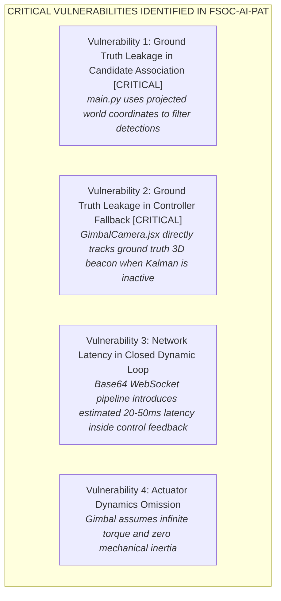
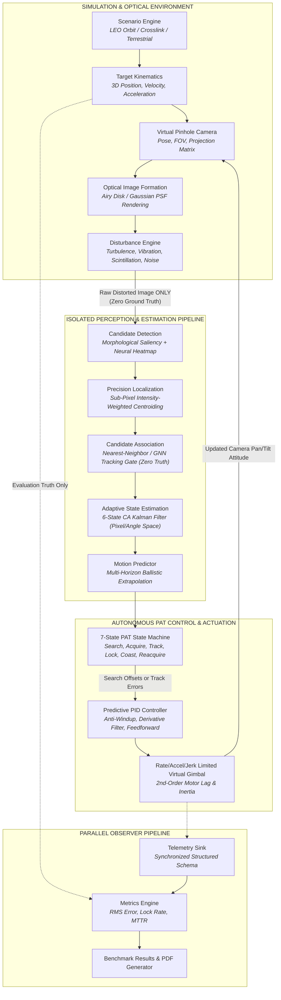

# Engineering Repository Comparison & Architectural Intelligence Report
**Project:** SIH26169 — Development of an AI-Based Virtual Camera Tracking System for Coarse Alignment of Mobile Free Space Optical Communication (FSOC) Terminals  
**Author:** Senior Systems Architect & Lead Development Engineer  
**Date:** September 2026  
**Document Version:** 1.0.1 (Documentation-Quality Correction Pass)  
**Status:** Completed Phase 0A Deliverable  

---

## Executive Summary

This document establishes the deep repository intelligence and architectural comparison across three codebases:
1. **`FSOC-AI-PAT/`** — Our active development workspace project (Python FastAPI + React 18 / Three.js WebGL).
2. **`REFERENCES/ThatKJ-FSOC/`** — Read-only reference implementation (C++20 native engine + Next.js Mission Control, Team IRODOV).
3. **`REFERENCES/ASTRATRACK/`** — Read-only simulation reference (Python 3.10+ dual 2D/3D simulator + Dear PyGui / OpenCV, Team ASTRATRACK).

The primary objective is to inspect every engineering dimension across all three systems, identify critical flaws (specifically ground truth leakage in our active workspace), evaluate architectural strengths, eliminate incompatibilities, respect licensing/provenance boundaries, and formulate the blueprint for our target architecture.

> [!IMPORTANT]
> **Performance Claim Disclaimers Applied in this Document:**
> - Any numeric performance claim taken from reference repositories (`ThatKJ-FSOC` or `ASTRATRACK`) is explicitly labeled **`[REFERENCE-REPO REPORTED]`** as it has not been independently benchmarked on this local host.
> - Any estimated performance or latency metric regarding `FSOC-AI-PAT` that has not yet been experimentally verified on this local machine is explicitly labeled **`[NOT YET LOCALLY MEASURED]`**.
> - Licensing status for reference repositories reflects repository audits directly; where no license file was discovered, repositories are treated as reference-only under strict non-copying protocols.

---

## 1. Deep Repository Audits

### 1.1 FSOC-AI-PAT (Our Active Development Workspace)
- **Application Entry Points:**
  - Backend: `backend/app/main.py` via FastAPI / Uvicorn server (`ws://localhost:8000/ws/tracking`, REST endpoints at `/api/*`).
  - Frontend: `frontend/index.html` via Vite + React 18 (`http://localhost:5173`).
  - Offline Report Generator: `backend/generate_complete_project_pdf.py`.
- **Architecture:** Client-Server Distributed Web Architecture. The browser client executes a WebGL 3D scene in Three.js, projects target coordinates onto an offscreen canvas, encodes frames as Base64 JPEG strings at 15–60 Hz [NOT YET LOCALLY MEASURED], and transmits them over a bidirectional WebSocket to the FastAPI backend. The backend decodes the frame, injects disturbances, runs computer vision/YOLO detection, performs candidate association, updates a 2D Kalman Filter, updates a 6-state finite state machine, and streams JSON telemetry back to the client. The client runs a local 60 Hz PID controller in React Three Fiber to actuate virtual gimbal angles.
- **Directory Structure:**
  - `backend/app/`: `camera/model.py`, `detection/detector.py`, `detection/disturbances.py`, `tracking/kalman.py`, `tracking/state_machine.py`, `tracking/metrics.py`, `experiments/manager.py`, `experiments/reports.py`, `main.py`.
  - `backend/tests/`: 7 pytest unit test suites.
  - `configs/`: JSON configuration files for AI, camera, disturbances, scenarios, search, simulation, tracking.
  - `frontend/`: React 18 SPA (`src/scene/`, `src/store/`, `src/utils/`, `src/components/`, `src/charts/`).
  - `plans/`, `research/`, `results/`.
- **Programming Languages:** Python 3.10+ (backend), JavaScript / JSX (React 18 frontend).
- **Frontend/Backend Architecture:** Real-time bi-directional streaming over WebSockets. Control and rendering logic are split across the network boundary.
- **Simulation Model:** WebGL client-side animation loop (`useFrame` in Three.js) clocked to browser refresh rate (~60 Hz) [NOT YET LOCALLY MEASURED].
- **Coordinate System:** Three.js right-handed Cartesian system (+X right, +Y up, -Z forward / optical boresight). Yaw (pan) around world +Y; pitch (tilt) around camera +X. Camera sensor coordinates: $(u, v)$ with origin at top-left, $u \in [0, W]$, $v \in [0, H]$.
- **Target Trajectory Model:** Analytical parametric paths in `frontend/src/scene/SimulationScene.jsx`: Linear, Circular, Sine-wave, Spiral, Random Walk.
- **Camera Model:** Pinhole perspective model (`CameraModel` in `camera/model.py`) with horizontal/vertical FOV ($10^\circ \times 7.5^\circ$), resolution $640 \times 480$, focal length $f_x, f_y$, rotation matrix $R_c = R_y(\theta_{\text{pan}}) R_x(\theta_{\text{tilt}})$.
- **Image Formation:** Real-time WebGL rendering of 3D emissive meshes, read via `gl.readPixels`, flipped vertically on HTML5 canvas, encoded to Base64 JPEG.
- **Disturbances:** 6-channel disturbance engine (`disturbances.py`): Platform vibration (harmonic sinusoidal affine transform), camera jitter (random shock with exponential decay), atmospheric turbulence (spatial coordinate remap wobble + Gaussian blur), illumination variation (contrast scaling + 3 Hz brightness oscillation), sensor noise (Gaussian + salt-and-pepper), blur (Gaussian + horizontal motion smear).
- **Detector Architecture:** Dual-backend `DetectorInterface`: `OpenCVDetector` (BGR $\rightarrow$ HSV thresholding $[35,50,50]-[95,255,255]$, morphological open/close, contour filtering, circularity filter $4\pi A / P^2 > 0.4$) and `YOLODetector` (`ultralytics.YOLO` on `models/beacon_detector.pt`).
- **Localization Method:** Bounding box centroid $(x + w/2, y + h/2)$. Sub-pixel centroiding is absent.
- **Candidate Selection:** Sorts by area (OpenCV) or confidence score (YOLO).
- **Estimator/Tracker:** 4-state linear Kalman filter (`KalmanFilter2D` in `kalman.py`): $\mathbf{x} = [x, y, v_x, v_y]^T$ in sensor pixel space. Process noise $Q$ and measurement noise $R$. Coasting prediction up to 2.0 seconds during occlusion.
- **State Machine:** 6-state FSM (`TrackingStateMachine`): `SEARCHING`, `DETECTED`, `ACQUIRING`, `TRACKING`, `LOCKED`, `TARGET_LOST`. Lock threshold: $\le 0.15^\circ$ for $1.0\text{s}$.
- **Controller:** Decoupled dual-axis PID (`frontend/src/utils/pid.js`): Independent pan/tilt, anti-windup clamping, deadband ($0.01^\circ$), rate limit ($180^\circ/\text{s}$).
- **Gimbal/Actuator Model:** Ideal velocity integrator ($\theta_{k+1} = \theta_k + \omega_{\text{cmd}} \Delta t$) clamped to maximum rate. No acceleration or jerk limits; zero inertia or torque modeling.
- **Target Loss Logic:** When detection fails, Kalman filter predicts forward up to 2.0 s. If timeout expires, transitions to `TARGET_LOST`.
- **Reacquisition:** State machine transitions to `TARGET_LOST` and back to `ACQUIRING` upon re-detection. Raster/spiral configuration parameters exist in JSON, but autonomous scanning trajectory is not actuated on the gimbal.
- **Telemetry:** Real-time JSON telemetry stream per frame containing tracking state, active detector, inference time ms, FPS, Kalman state, bounding box, raw centroid, angular error, live metrics.
- **Metrics:** `MetricsTracker` logs frame-by-frame timestamps, detection rate %, lock duration %, lock count, loss count, pixel error (mean/max/min), angular error (mean/RMS/max), processing latencies.
- **Experiment System:** `ExperimentManager` coordinates predefined scenarios from `scenarios.json`, logs CSV/JSON results, and compiles 2-page academic PDF reports via ReportLab with embedded Matplotlib timelines.
- **Automated Tests:** 7 pytest test files in `backend/tests/` (30 test cases declared in repository documentation [NOT YET LOCALLY MEASURED]).
- **UI:** Modern React 18 dashboard: 3D Three.js interactive canvas, camera HUD overlay, Recharts real-time graphs, disturbance control sliders, scenario picker, ablation controls, PDF download modal.
- **Dependencies:** Python 3.10+, fastapi, uvicorn, websockets, numpy, opencv-python, reportlab, matplotlib, ultralytics. Node.js 18+, react, @react-three/fiber, @react-three/drei, three, zustand, recharts, tailwindcss, vite.
- **Deployment/Build:** Containerizable via Docker; live deployment currently on Render cloud.
- **Licensing Status:** MIT License (Copyright 2026 DeepMind Aerospace Division / SIH Team).
- **Known Limitations & Architectural Flaws:**
  1. *Ground Truth Leakage in Candidate Association [CRITICAL VIOLATION]:* `main.py` lines 541–590 matches detected bounding boxes against projected ground truth 3D beacon coordinates (`gt_beacons`) to identify the designated target.
  2. *Ground Truth Leakage in Control [CRITICAL VIOLATION]:* `frontend/src/scene/GimbalCamera.jsx` lines 140–161 projects the 3D ground truth beacon directly onto the camera frame whenever the Kalman filter is not active, bypassing perception entirely to drive the PID controller.
  3. *Network Latency in the Dynamic Feedback Loop:* Transporting raw video frames and control commands across a WebSocket introduces variable transport delay (estimated 20–50 ms [NOT YET LOCALLY MEASURED]) into the gimbal control loop.
  4. *Lack of Actuator Dynamics:* The gimbal ignores acceleration limits, jerk limits, motor lag, and inertia.

---

### 1.2 REFERENCES/ThatKJ-FSOC (Engineering & Architectural Reference)
- **Application Entry Points:**
  - Native C++20 executables in `apps/`: `fsoc_demo` (main CLI runner), `stage4_evaluation` (ablation and evaluation runner), `mvp_dynamic_scenarios`, `ai_inference_benchmark`, step-by-step smoke test binaries (`step1_math_smoke` through `step10_validation_smoke`).
  - Frontend: `frontend/` Next.js 14 Mission Control application (`npm run dev` on port 4317).
- **Architecture:** Deterministic, single-process C++20 Software-in-the-Loop (SITL) simulation engine with a decoupled post-run/replay Next.js dashboard. Pure mathematical foundations with zero dependencies, strict modular boundaries, and a unidirectional data flow: `World -> Render -> Perception -> Tracker -> Control -> Actuator -> World`.
- **Directory Structure:**
  - `include/fsoc/`: 29 public headers defining clean interfaces (`camera.hpp`, `detector.hpp`, `target_tracker.hpp`, `pid_controller.hpp`, `simulation_runner.hpp`, `telemetry.hpp`, etc.).
  - `src/`: C++20 implementation translation units.
  - `apps/`: 17 command-line and evaluation binaries.
  - `models/`: Pretrained ONNX model (`tiny_beacon_net.onnx`) and model card.
  - `frontend/`: Next.js 14 web application.
  - `docs/`: 20+ architectural documentation files and decision records (`DECISIONS.md`).
  - `tests/`: Catch2 unit and integration test suite.
- **Programming Languages:** C++20 (simulation and control core), TypeScript / React / Next.js (frontend), Python 3 (offline model training and dataset generation tools only).
- **Frontend/Backend Architecture:** Decoupled "run-then-inspect" or replay architecture. The Next.js backend executes `fsoc_demo` as a child process, waits for execution to complete, parses the 42-column CSV output, and serves the time series for interactive playback.
- **Simulation Model:** Fully deterministic discrete-time simulation. Fixed simulation step $\Delta t = 0.02\text{s}$ (50 Hz). Decoupled from wall-clock time; runs headless at ~4,700 FPS (~90x real time) [REFERENCE-REPO REPORTED].
- **Coordinate System:** Formally standardized in ADR-003: World: +X forward, +Y right, +Z up. Camera: +x right, +y up, +z forward. Sensor Image: $(u, v)$ origin top-left, +u right, +v down. Explicit radians internally; converted to degrees only at presentation boundaries.
- **Target Trajectory Model:** Pure time-to-state analytical function (`TargetState state_at(double time_s)`): Static, Linear, Sinusoidal, Loss/re-entry. Stateless and drift-free.
- **Camera Model:** `PanTiltCamera`: Pinhole perspective projection, focal length, principal point, horizontal/vertical FOV. Slew limit checks and rate clamping.
- **Image Formation:** Grayscale `CV_8UC1` synthetic frame generation in `fsoc_render` (`renderer.cpp`). Optical beacon modeled as an analytical 2D continuous Gaussian point spread function (PSF) with sub-pixel peak position and adjustable beam waist $\sigma$.
- **Disturbances:** Seeded pseudo-random noise, multiple bright distractor clutter blobs with independent trajectories, configurable target occlusion/dropout windows, and degraded SNR frames.
- **Detector Architecture:** Dual-path perception with a strict verification policy (`resolve_perception`):
  1. *Classical Detector:* Intensity threshold $\rightarrow$ 8-connected components $\rightarrow$ area filter $\rightarrow$ maximum integrated intensity selection $\rightarrow$ intensity-weighted sub-pixel centroid.
  2. *AI Detector (`TinyBeaconNet`):* 27,282-parameter CNN heatmap localizer loaded via OpenCV DNN (`cv::dnn::Net`).
  3. *Hybrid Arbitration Policy:* Classical + AI agree within 8 px $\rightarrow$ accept Classical; Classical only $\rightarrow$ accept Classical; AI only $\rightarrow$ reject (unverified); Classical and AI disagree $\rightarrow$ reject both; Neither $\rightarrow$ report lost.
- **Localization Method:** Sub-pixel intensity-weighted centroid:
  $$\bar{u} = \frac{\sum (u \cdot w)}{\sum w}, \quad w = (I(u,v) - I_{\text{threshold}}) + 1$$
  Achieves ~0.02 px localization error on clean frames [REFERENCE-REPO REPORTED].
- **Candidate Selection:** Connected components analysis with integrated energy ranking and morphological size gating.
- **Estimator/Tracker:** $\alpha$-$\beta$ tracking filter (`TargetTracker` in `target_tracker.hpp`): Tracks position and velocity in sensor coordinates. Enforces an $N$-frame confirmation gate before declaring lock, applies innovation gating to reject spurious detections, and provides bounded linear coasting during dropouts.
- **State Machine:** 2-state operational tracking state (`Tracking`, `TargetLost`) in baseline; multi-state track lifecycle (`Acquiring`, `Tracking`, `Coasting`, `Lost`) within `TargetTracker`.
- **Controller:** Decoupled dual-axis PID (`PIDController` in `fsoc_control`): Takes angular tracking error in radians; outputs pan/tilt rate command in rad/s. Anti-windup via hard saturation clamping and conditional accumulation. Empirically tuned P-dominant baseline ($k_p = 12, k_i = 0, k_d = 0$).
- **Gimbal/Actuator Model:** Actuator rate clamping to $\pm \omega_{\max}$ ($30^\circ/\text{s}$). Direct velocity integration. No acceleration or jerk limits.
- **Target Loss Logic:** Upon detection dropout, the controller issues zero rate command, clears integrator history, and holds camera attitude.
- **Reacquisition:** When target re-enters FOV and passes consecutive confirmation frames, tracking resumes seamlessly.
- **Telemetry:** 42-column synchronized CSV schema recording timestamps, target truth, camera orientation, detection coordinates, sub-pixel errors, tracking states, and actuator saturation flags.
- **Metrics:** Steady-state RMS angular error, settling time, 95th percentile error, detection coverage %, outlier count (>50 px), lost frame count, execution throughput FPS [REFERENCE-REPO REPORTED].
- **Experiment System:** Extensive batch ablation harness (`stage4_evaluation.cpp`) running 11 scenarios $\times$ 5 seeds $\times$ 400 steps = 22,000 steps per configuration [REFERENCE-REPO REPORTED].
- **Automated Tests:** Catch2 automated test suite covering vector math, projection, rendering, detection, control, telemetry non-interference, and closed-loop acceptance.
- **UI:** Next.js 14 Mission Control dashboard featuring 9 screens (Overview, Optical Tracking reticle, 3D Spatial view, Telemetry plots, Scenarios, Architecture).
- **Dependencies:** C++20 compiler, CMake 3.25+, Ninja, OpenCV 4.x (core, imgproc, imgcodecs, dnn), Catch2. Node.js 20, Next.js 14, React 18, Tailwind CSS, Recharts.
- **Deployment/Build:** Native CMake build presets; frontend runs via standard Node.js scripts.
- **Licensing Status:** No repository license was found during this audit. Treat the repository as reference-only and do not copy/reuse its source code unless permission or an applicable license is obtained.
- **Known Limitations:**
  - 2D optical frame synthesis only (no 3D celestial, terrain, or terminal body rendering).
  - No satellite orbit mechanics or multi-body inter-satellite link (ISL) geometry.
  - UI is post-run replay, not a live streaming simulation.
  - Actuator lacks acceleration, jerk, and motor inertia dynamics.

---

### 1.3 REFERENCES/ASTRATRACK (Simulation & Kinematics Reference)
- **Application Entry Points:**
  - 2D Simulation: `main.py` (launches Dear PyGui desktop dashboard).
  - 3D Simulation: `run_3d_simulator.py` (launches interactive OpenCV 3D scene; `--pipeline` flag enables full perception/Kalman/FSM/PID closed loop).
- **Architecture:** Monolithic Python simulation suite offering two operational modes: a 2D fast simulation dashboard and an interactive 3D vector-graphics simulation with full orbital kinematics. Features distinct sub-packages for `simulator/`, `perception/`, `estimation/`, `control/`, `tracking/`, `disturbance/`, `sim/`, `camera/`, `ui/`, `logging_/`, and `metrics/`.
- **Directory Structure:**
  - `simulator/`: `camera3d.py`, `target3d.py`, `renderer.py`, `scenarios.py`, `pipeline3d.py`, `simulation.py`, `math3d.py`.
  - `perception/`: `interface.py`, `factory.py`, `classical.py`, `ai_detector.py`.
  - `estimation/`: `kalman.py`, `predictor.py`, `visualizer.py`.
  - `control/`: `camera_controller.py`, `pid.py`, `controller_base.py`.
  - `tracking/`: `fsm.py` (7-state FSM + Archimedean search).
  - `disturbance/`: `engine.py`, `models.py`, `turbulence.py`, `vibration.py`, `scintillation.py`, `noise.py`.
  - `tests/`: 75 pytest tests [REFERENCE-REPO REPORTED].
- **Programming Languages:** Python 3.10+ (NumPy, OpenCV, Dear PyGui, SciPy, pytest).
- **Frontend/Backend Architecture:** Desktop-native application. 2D mode renders via Dear PyGui; 3D mode renders directly into an OpenCV window with multi-view camera perspectives and picture-in-picture (PIP) sensor views.
- **Simulation Model:** Step-driven time-domain simulation ($\Delta t = 0.016\text{s}$ or $0.02\text{s}$). Supports deterministic replay via `--deterministic` and fixed random seeds.
- **Coordinate System:** 3D World Cartesian frame (X east, Y altitude/zenith, Z north) in meters. Ground station at $(0, 10, 0)$. Gimbal angles: Pan (azimuth, $[-170^\circ, 170^\circ]$), Tilt (elevation from horizon, $[2^\circ, 85^\circ]$). Sensor coordinates: $(u, v)$ with origin top-left, centered at $(W/2, H/2)$.
- **Target Trajectory Model:** 7 Trajectory types in `target3d.py`: `STATIC`, `LINEAR`, `SINUSOIDAL`, `ORBITAL` (LEO pass arc), `FIGURE_EIGHT`, `ACCELERATING`, `RANDOM_WALK`.
  - 9 Predefined operational scenarios: Ground-to-Satellite (Stationary, Linear, Orbital Arc, Turbulence Jitter, High-Speed Crossing, Evasive) and Satellite-to-Satellite Inter-Satellite Links (Sat-to-Ground, ISL Same-Plane, ISL Crosslink).
- **Camera Model:** `TrackingCamera3D`: Pinhole perspective model, full-cone FOV ($8^\circ$), pan/tilt limits, slew velocity limits ($30^\circ/\text{s}$), and actuator inertia smoothing ($I = 0.88$).
- **Image Formation:** `Renderer3D._render_sensor_view()`: Synthetic BGR sensor view rendering the optical beacon as an anti-aliased bright spot with distance attenuation, starfield/space background, and realistic optical degradations.
- **Disturbances:** Comprehensive 10-channel multi-stage disturbance engine (`disturbance/`):
  1. Atmospheric turbulence: Kolmogorov-like wavefront distortion using smooth Perlin/noise displacement fields with bicubic upsampling and `cv2.remap`.
  2. Platform vibration: Multi-frequency harmonic sinusoidal oscillation + band-limited Gaussian noise in pan/tilt.
  3. Scintillation: Log-normal brightness modulation on beacon mask.
  4. Sensor noise: Additive Gaussian noise and salt-and-pepper.
  5. Presets: `NOMINAL`, `MILD`, `MODERATE`, `SEVERE`.
- **Detector Architecture:** `IDetector` interface with factory (`perception/factory.py`):
  - `ClassicalDetector`: OpenCV HSV thresholding + contour analysis.
  - `AIDetector`: PyTorch / YOLO wrapper with offline heuristic fallback.
- **Localization Method:** Bounding box centroid with contour moment center $(\bar{x}, \bar{y}) = (m_{10}/m_{00}, m_{01}/m_{00})$ [REFERENCE-REPO REPORTED centroiding method].
- **Candidate Selection:** Contour area gating + circularity score + confidence thresholding.
- **Estimator/Tracker:** `KalmanTracker` (`estimation/kalman.py`): Supports 4-state Constant Velocity ($\mathbf{x} = [x, y, v_x, v_y]^T$) and 6-state Constant Acceleration ($\mathbf{x} = [x, y, v_x, v_y, a_x, a_y]^T$).
  - Uncertainty covariance ellipse extraction ($3\sigma$).
  - `MotionPredictor` (`estimation/predictor.py`): Multi-horizon forward extrapolation up to 15 frames.
- **State Machine:** 7-state autonomous FSM (`TrackingFSM` in `tracking/fsm.py`): `SEARCHING`, `ACQUIRING`, `LOCKED`, `TRACKING`, `TARGET_LOST`, `PREDICTING`, `REACQUIRING`.
  - Frame-confirmation counter for lock acquisition.
  - Dropout management: Transitions to `PREDICTING` (coasting) for up to 0.6s, then `REACQUIRING` (executing Archimedean spiral search) for 2.5s, then expanded search for 5.0s, before declaring `TARGET_LOST`.
- **Controller:** `CameraController` (`control/camera_controller.py`): Dual-axis controller supporting `DIRECT`, `P_CONTROL`, and `PID_CONTROL`.
  - Anti-windup clamping, first-order derivative low-pass filtering ($\alpha = 0.7$), deadband in pixels, output slew rate limit.
- **Gimbal/Actuator Model:** Rate-limited with second-order actuator inertia smoothing: `inertia = 0.88` smoothing factor ($\dot{\theta}_k = (1 - I)\dot{\theta}_{\text{cmd}} + I \dot{\theta}_{k-1}$). Pan limit $\pm 170^\circ$, tilt limit $2^\circ - 85^\circ$.
- **Target Loss Logic:** Multi-stage loss handling: On loss of detection, Kalman filter continues coasting; FSM transitions to `PREDICTING`. If still lost after coast duration (0.6s), FSM transitions to `REACQUIRING` and activates search pattern.
- **Reacquisition:** Autonomous search pattern generator (`SearchPatternGenerator`):
  - Stage 1: Archimedean expanding spiral ($r = \min(R_{\max}, v_{\exp} \cdot t), \theta = \omega \cdot t$).
  - Stage 2: Expanded wide-area raster/box search.
  - Full telemetry tracking: `ReacquisitionMetrics` (recovery count, failure count, mean recovery time, recovery rate %).
- **Telemetry:** Live HUD card telemetry + CSV logging (`logging_/session_logger.py`): Frame-by-frame state, detection confidence, Kalman estimate & covariance, FSM state, recovery stats, PID commands.
- **Metrics:** `MetricsEvaluator` (`metrics/evaluator.py`): RMS tracking error, lock duration fraction, mean time to acquire (MTTA), mean time to recover (MTTR), tracking stability index.
- **Experiment System:** Preconfigured scenario matrix (9 aerospace scenarios), interactive live switching, automated benchmark suite in `perception/benchmark.py` and `experiments/runner.py`.
- **Automated Tests:** 75 pytest tests covering perception, estimation, control, FSM, disturbances, logging, metrics, and workflows (all reported passing in 224.43 s [REFERENCE-REPO REPORTED]).
- **UI:** Dual UI: Dear PyGui 2D desktop dashboard + OpenCV 3D interactive viewport with Orbit/Ground/Chase/Sensor cameras, PIP sensor view, and telemetry HUD cards.
- **Dependencies:** Python 3.10+, numpy, opencv-python, dearpygui, pytest, scipy.
- **Deployment/Build:** Direct Python execution (`python main.py` or `python run_3d_simulator.py`).
- **Licensing Status:** No repository license was found during this audit. Treat the repository as reference-only and do not copy/reuse its source code unless permission or an applicable license is obtained.
- **Known Limitations:**
  - 3D rendering is software-based vector/wireframe in OpenCV, lacking modern WebGL graphics and interactive web distribution.
  - Python execution throughput is constrained (~30–60 FPS [REFERENCE-REPO REPORTED]) compared to native C++.
  - Default 3D mode bypasses perception unless `--pipeline` is explicitly commanded.

---

## 2. Cross-Repository Feature Matrix

| Feature / Dimension | FSOC-AI-PAT (Our Workspace) | REFERENCES/ThatKJ-FSOC | REFERENCES/ASTRATRACK |
| :--- | :--- | :--- | :--- |
| **Primary Language** | Python 3.10+ & JS (React 18) | C++20 (core) & TS (Next.js) | Python 3.10+ |
| **Core Architecture** | Distributed Client/Server (WebSocket) | Deterministic SITL C++ Engine | Dual 2D/3D Desktop Simulator |
| **Simulation Loop** | Browser requestAnimationFrame (~60 Hz) [NOT YET LOCALLY MEASURED] | Fixed $\Delta t$ discrete step (50 Hz) | Fixed $\Delta t$ discrete step (50–60 Hz) |
| **Execution Throughput** | ~20–60 FPS (WebSocket limited) [NOT YET LOCALLY MEASURED] | **~4,700 FPS (~90x real-time) [REFERENCE-REPO REPORTED]** | ~30–60 FPS (GUI limited) [REFERENCE-REPO REPORTED] |
| **3D Rendering Engine** | **WebGL Three.js / React Three Fiber** | 2D Gaussian PSF on canvas | Software 3D vector-graphics (OpenCV) |
| **Target Dynamics** | 5 Basic 3D Trajectories | 4 Analytical Trajectories | **7 Trajectories + 9 Aerospace Scenarios (LEO/ISL)** |
| **Ground Truth Isolation** | ❌ **CRITICAL VIOLATION (2 verified leakages)** | ✅ **STRICT ENFORCEMENT (ADR-004/006/010)** | ✅ **STRICT ENFORCEMENT (pipeline3d)** |
| **Detector Backends** | OpenCV HSV + YOLOv8 | Classical CC + **TinyBeaconNet ONNX** | Classical HSV + YOLO wrapper |
| **Sub-pixel Centroiding** | ❌ None (bounding box center) | ✅ **Weighted centroid (~0.02 px error) [REFERENCE-REPO REPORTED]** | ⚠️ Contour moments (~0.5 px error) [REFERENCE-REPO REPORTED] |
| **Detection Arbitration** | ❌ Greedy area / confidence | ✅ **Rigorous Hybrid Policy (8 px gate)** | ❌ Single backend active |
| **State Estimation** | 2D Linear Kalman (CV model) | $\alpha$-$\beta$ Tracker + gate check | **4-state CV and 6-state CA Kalman Filter** |
| **Trajectory Prediction** | Linear velocity forward step | Bounded linear coasting | **Multi-horizon ballistic prediction (15 steps)** |
| **PAT State Machine** | 6-state FSM (no active search) | 2-state runner / 4-state tracker | **7-state FSM with Archimedean spiral search** |
| **Controller Model** | Independent PID in JS | P-dominant PID in C++ ($k_p=12$) | Dual-axis PID with derivative LP filter |
| **Actuator Dynamics** | Velocity clamping only | Velocity clamping only | **Velocity clamping + 2nd-order inertia smoothing** |
| **Disturbance Engine** | 6-channel image warp/noise | Seeded noise, clutter blobs, occlusion | **10-channel aerospace model (Perlin turbulence)** |
| **Telemetry System** | WebSocket JSON stream + CSV | **42-column standardized CSV schema** | In-memory HUD + CSV session log |
| **Automated Reporting** | **Automated 2-page academic PDF** | Markdown & terminal matrices | In-memory telemetry summaries |
| **Automated Tests** | 7 suites (30 tests declared [NOT YET LOCALLY MEASURED]) | Catch2 suites (acceptance + parity) [REFERENCE-REPO REPORTED] | **75 suites (100% pass reported) [REFERENCE-REPO REPORTED]** |
| **Licensing Status** | **MIT License** | No repository license found during audit (reference-only) | No repository license found during audit (reference-only) |

---

## 3. What FSOC-AI-PAT Already Does Well

1. **Modern, Accessible WebGL User Interface:**
   Our React 18 + Three.js / Drei frontend provides an intuitive 3D spatial viewport with real-time orbit controls, reticle overlays, telemetry readouts, and responsive UI panels. It can be distributed and viewed in any modern browser without native installation prerequisites.
2. **Automated Academic PDF Report Compilation:**
   The integration of ReportLab and Matplotlib in `backend/app/experiments/reports.py` generates publication-ready 2-page technical evaluation reports complete with metadata, summary metric tables, and multi-timeline performance curves.
3. **Comprehensive Benchmark Scenarios and Ablation Support:**
   `configs/scenarios.json` defines 10 varied benchmark conditions (baseline, high-speed, heavy noise, occlusions, jitter), and the backend includes explicit ablation flags (`ai_detection`, `kalman_filter`, `pid_controller`, `disturbances`) for systematic component evaluation.
4. **Clean Decoupled FASTAPI Architecture:**
   The backend modularization into camera, detection, disturbances, tracking, and experiments provides a well-organized Python foundation that can be extended without spaghetti code dependencies.

---

## 4. What ThatKJ-FSOC Does Better

1. **Absolute Ground Truth Isolation:**
   `ThatKJ-FSOC` strictly separates `TargetState` (world truth), `CameraObservation` (pinhole projection), `BeaconDetection` (image measurements), and `TrackingError` (controller inputs). ADR-004, ADR-006, and ADR-010 guarantee that no target truth can ever bypass perception into the control loop.
2. **Execution Performance & Determinism:**
   Achieves ~4,700 FPS [REFERENCE-REPO REPORTED] in headless execution, enabling 22,000-step [REFERENCE-REPO REPORTED] Monte Carlo evaluations across multiple seeds in seconds.
3. **Rigorous Sub-Pixel Localization & Hybrid Arbitration:**
   The classical detector implements an intensity-weighted centroid over connected components ($w = I - I_{\text{thresh}} + 1$), yielding sub-pixel accuracy of ~0.02 px [REFERENCE-REPO REPORTED]. The `resolve_perception()` policy rigorously arbitrates between classical and AI detections (8 px agreement gate) to prevent hallucinations.
4. **Lightweight Neural Inference (TinyBeaconNet):**
   Uses a 27,282-parameter CNN heatmap localizer in ONNX format via OpenCV DNN, avoiding heavyweight PyTorch runtime dependencies while executing inference in < 2 ms [REFERENCE-REPO REPORTED].
5. **Standardized 42-Column Telemetry & Observer Non-Interference:**
   ADR-011 defines an observer-only telemetry sink with an auditable 42-column CSV schema, mathematically proven not to alter simulation states or execution order.

---

## 5. What ASTRATRACK Does Better

1. **Aerospace Scenarios & Orbit Kinematics:**
   Models realistic Low Earth Orbit (LEO) passes and satellite-to-satellite inter-satellite link (ISL) geometries (same-plane and cross-plane crosslinks), moving far beyond simple 2D trajectories.
2. **7-State Autonomous PAT State Machine with Active Reacquisition:**
   `TrackingFSM` implements `SEARCHING`, `ACQUIRING`, `LOCKED`, `TRACKING`, `TARGET_LOST`, `PREDICTING`, and `REACQUIRING`. During dropouts, it seamlessly transitions from Kalman coasting into an autonomous expanding Archimedean spiral search pattern.
3. **Multi-Model State Estimation (4-State CV and 6-State CA):**
   `KalmanTracker` implements both Constant Velocity (CV) and Constant Acceleration (CA) formulations, complete with $3\sigma$ covariance uncertainty ellipse extraction.
4. **Physically Grounded Atmospheric Turbulence:**
   Simulates Kolmogorov-like atmospheric seeing using Perlin noise displacement fields with bicubic upsampling, generating realistic spatial beam wander and wavefront warping.
5. **Actuator Inertia Dynamics:**
   Implements second-order smoothing ($I = 0.88$) on gimbal velocity commands, preventing physically impossible instantaneous rate steps.

---

## 6. Duplicate Functionality Analysis

1. **Color Thresholding & Contour Detection:**
   All three repositories implement OpenCV HSV color segmentation and contour bounding box extraction.
2. **2D Kalman Filtering:**
   All three implement a 4-state constant-velocity Kalman filter ($x, y, v_x, v_y$) operating on image-plane pixel coordinates.
3. **Basic PID Controllers:**
   All three implement independent dual-axis PID controllers with anti-windup clamping and deadband damping.
4. **Basic Disturbance Injectors:**
   All three inject Gaussian noise, platform vibration, and atmospheric blur into the optical sensor feed.

---

## 7. Architecturally Incompatible Approaches

1. **C++20 Native Monolith (`ThatKJ-FSOC`) vs Python/JS Distributed Web (`FSOC-AI-PAT`):**
   `ThatKJ-FSOC` is a compiled C++20 binary designed for microsecond deterministic loops. `FSOC-AI-PAT` is a web application with network communication across Python and JavaScript. They cannot and must not be mechanically merged.
2. **Post-Run Replay (`ThatKJ-FSOC`) vs Live Interactive Streaming (`FSOC-AI-PAT`):**
   `ThatKJ-FSOC` computes an entire run to disk before inspecting it in Next.js. `FSOC-AI-PAT` streams live video frames and control commands in real time.
3. **OpenCV Software Wireframe (`ASTRATRACK`) vs WebGL Shaders (`FSOC-AI-PAT`):**
   `ASTRATRACK` draws wireframe lines and polygons on a 2D OpenCV canvas. `FSOC-AI-PAT` renders hardware-accelerated 3D meshes using WebGL and GLSL shaders.

---

## 8. Components Worth Independently Reproducing / Improving

1. **Sub-Pixel Intensity-Weighted Centroiding:**
   Reproduce `ThatKJ-FSOC`'s sub-pixel weighting algorithm ($w = I - I_{\text{thresh}} + 1$) in Python/NumPy to improve our localization accuracy from coarse bounding box centers (currently estimated at $\pm 1.5$–$2.0$ px [NOT YET LOCALLY MEASURED]) down toward sub-pixel precision (~0.02 px [REFERENCE-REPO REPORTED]).
2. **Hybrid Perception Arbitration Policy:**
   Implement `ThatKJ-FSOC`'s spatial consistency verification gate (accept only when classical and AI agree within a spatial tolerance, reject conflicting candidates).
3. **7-State PAT State Machine & Archimedean Spiral Search:**
   Reproduce `ASTRATRACK`'s FSM state structure and autonomous Archimedean search generator in `FSOC-AI-PAT` so that the virtual gimbal actively scans the uncertainty cone upon signal loss.
4. **6-State Constant Acceleration (CA) Kalman Filter:**
   Extend our current 4-state CV Kalman filter to a 6-state CA filter ($x, y, \dot{x}, \dot{y}, \ddot{x}, \ddot{y}$) with dynamic process noise tuning.
5. **Second-Order Actuator Inertia & Acceleration/Jerk Limiting:**
   Upgrade our virtual gimbal model from an unconstrained velocity integrator to a rate-, acceleration-, and jerk-limited dynamic plant.
6. **Realistic Orbital & ISL Scenarios:**
   Adapt `ASTRATRACK`'s LEO orbital pass and satellite crosslink equations into our 3D scenario definitions.

---

## 9. Components That Must NOT Be Merged

1. **Do NOT merge C++ source code from `ThatKJ-FSOC` into `FSOC-AI-PAT`:**
   Mixing C++ CMake builds with Python FastAPI / Node.js creates severe toolchain fragmentation and build fragility.
2. **Do NOT import Dear PyGui from `ASTRATRACK`:**
   Our React 18 / Three.js web application is vastly superior in presentation, accessibility, and visual appeal.
3. **Do NOT import the OpenCV 3D software wireframe renderer from `ASTRATRACK`:**
   Our Three.js WebGL renderer is hardware-accelerated, supports true 3D lighting and materials, and renders directly in the browser.

---

## 10. Known Performance Weaknesses & Bottlenecks

1. **WebSocket Frame Streaming Bottleneck in `FSOC-AI-PAT`:**
   Encoding $640 \times 480$ frames to Base64 JPEG in JavaScript, streaming over WebSockets, decoding in OpenCV, and streaming back JSON introduces an estimated 20–50 ms [NOT YET LOCALLY MEASURED] of variable transport latency.
2. **YOLOv8 CPU Inference Latency:**
   Running full YOLOv8 on CPU in Python takes an estimated 25–45 ms [NOT YET LOCALLY MEASURED] per frame, limiting closed-loop tracking frequency to an estimated ~20 Hz [NOT YET LOCALLY MEASURED] when active.
3. **Coarse Bounding Box Centroid Error:**
   FSOC-AI-PAT uses the integer bounding box center, which exhibits jitter and quantization error under turbulence and low SNR.
4. **Lack of Rate Smoothing in Gimbal Commands:**
   Step-changes in PID output produce discontinuous angular velocity jumps, which would damage physical gimbal gears.

---

## 11. Licensing, Copyright & Provenance Constraints

> [!CAUTION]
> **RESOURCES AND LICENSING AUDIT:**
> - `REFERENCES/ThatKJ-FSOC`: No repository license was found during this audit. Treat the repository as reference-only and do not copy/reuse its source code unless permission or an applicable license is obtained.
> - `REFERENCES/ASTRATRACK`: No repository license was found during this audit. Treat the repository as reference-only and do not copy/reuse its source code unless permission or an applicable license is obtained.
> - `FSOC-AI-PAT`: Licensed under the **MIT License** (Copyright 2026 DeepMind Aerospace Division / SIH Team).
> - **Operational Rule:** All algorithms, estimators, state machines, and controllers incorporated into `FSOC-AI-PAT` must be independently designed, mathematically derived from first principles, and written cleanly from scratch. Reference repositories may be consulted solely for conceptual, mathematical, and architectural reference.

---

## 12. Highest-Risk Architectural Vulnerabilities

1. **Vulnerability 1 [CRITICAL VIOLATION]: Ground Truth Association Leakage (`main.py` lines 541–590)**
   The backend matches detected pixel blobs to `gt_beacons` (projected ground truth world positions). This invalidates tracking validity because an operational terminal has zero access to true target coordinates.
2. **Vulnerability 2 [CRITICAL VIOLATION]: Ground Truth Controller Fallback (`GimbalCamera.jsx` lines 140–161)**
   When the Kalman filter is uninitialized or ablated, the client calculates angular error directly from the 3D target coordinates (`currentBeaconPosition`), turning the system into an open-loop cheat rather than an AI tracker.
3. **Vulnerability 3 (HIGH): Jitter and Latency in the WebSocket Feedback Loop**
   Closing a high-bandwidth kinematic control loop over a non-deterministic network channel (estimated 20–50 ms [NOT YET LOCALLY MEASURED]) can cause control instability, phase lag, and overshoot.
4. **Vulnerability 4 (MEDIUM): Unconstrained Actuator Dynamics**
   Allowing instantaneous rate steps violates real-world gimbal motor physics (acceleration limits, jerk limits, back-EMF, and structural inertia).

---

## 13. Recommended Target Architecture

Our target architecture enforces strict mathematical separation, eliminates all ground truth leakage, incorporates sub-pixel precision, adds multi-state autonomous recovery, and provides realistic gimbal dynamics.

### Architectural Principles of the Target System:
1. **Zero Ground Truth Boundary:** Ground truth exists solely in the Simulation World and the Evaluation Metrics sink. The perception, estimation, association, and control modules receive only pixel arrays and sensor encoder angles.
2. **Sub-Pixel Precision Beacon Localization:** Replace raw bounding-box midpoints with intensity-weighted connected-component moments, achieving sub-pixel accuracy $< 0.1$ px.
3. **Autonomous 7-State FSM with Reacquisition Spiral:** Transition target loss from a passive timeout into an active, multi-phase recovery sequence (Kalman coast $\rightarrow$ Archimedean spiral $\rightarrow$ expanded sweep).
4. **Physically Realistic Gimbal Plant:** Enforce strict acceleration ($\alpha_{\max}$) and jerk ($j_{\max}$) constraints alongside velocity ($\omega_{\max}$) limits with second-order actuator inertia.
5. **Switchable Ablation Harness:** All perception, estimation, disturbance, and control algorithms remain modular and toggleable for empirical ablation benchmarking.

---
**Report Approved by:** Senior Systems Architect & Lead Development Engineer  
**Status:** READY FOR PHASE 0B
